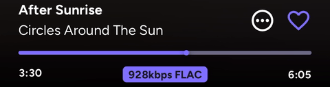
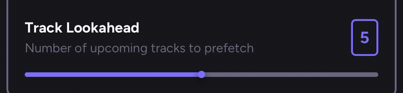

# @jellify-music/react-native-reanimated-slider

A performant, customizable slider component for React Native, powered by React Native Gesture Handler and Reanimated.

<table>
  <tr>
    <td align="center" valign="middle" width="50%">
      
    </td>
    <td align="center" valign="middle" width="50%">
      
    </td>
  </tr>
  <tr>
    <td align="center"><em>Smooth, tappable slider in the Jellify player</em></td>
    <td align="center"><em>Stepped slider with springy resistance for track lookahead</em></td>
  </tr>
</table>

## Intro

We built this slider for [Jellify](https://github.com/Jellify-Music/App) to have an easily customizable and performant slider with minimal dependencies. Leveraging Reanimated and Gesture Handler, this library uses the modules you already know and love - and works instantly in your project.

## Features

- Smooth gesture handling with tap and pan support
- Powered by Reanimated for 60fps animations
- Fully customizable colors and shadows
- Horizontal and vertical orientations
- Step intervals that snap the slider to fixed values
- Works on iOS and Android

## Installation

```sh
npm install @jellify-music/react-native-reanimated-slider
# or
yarn add @jellify-music/react-native-reanimated-slider
# or
bun add @jellify-music/react-native-reanimated-slider
```

### Peer Dependencies

This library requires the following peer dependencies:

- `react-native-reanimated: ">= 4.3.0"`
- `react-native-worklets: ">= 0.9.1"`
- `react-native-gesture-handler: ">= 3.0.0"`

## Usage

```tsx
import Slider from '@jellify-music/react-native-reanimated-slider';
import { useSharedValue } from 'react-native-reanimated';

function MyComponent() {
  const progress = useSharedValue(0);

  return (
    <Slider
      value={progress}
      onValueChange={(value) => {
        console.log('Slider value:', value);
      }}
      maxValue={100}
      thumbWidth={24}
      trackHeight={8}
      backgroundColor="#e0e0e0"
      color="#6200ee"
      thumbShadowColor="#000"
    />
  );
}
```

### Number Values

`value` also accepts a plain `number`, for when you don't need a shared value. The slider follows the number as it changes, except while the user is dragging it:

```tsx
const [volume, setVolume] = useState(0.5);

<Slider
  value={volume}
  onValueChange={setVolume}
  maxValue={1}
  thumbWidth={24}
  trackHeight={8}
  backgroundColor="#e0e0e0"
  color="#6200ee"
/>;
```

### Vertical Orientation

Set `orientation="vertical"` to render a vertical slider. Vertical sliders fill from bottom to top and stretch to the height of their parent, so give the parent a height:

```tsx
<View style={{ height: 200 }}>
  <Slider
    orientation="vertical"
    value={volume}
    onValueChange={onVolumeChange}
    maxValue={1}
    thumbWidth={24}
    trackHeight={8}
    backgroundColor="#e0e0e0"
    color="#6200ee"
  />
</View>
```

### Step Intervals

Set `step` to snap the slider to multiples of an interval. The thumb ratchets between steps while dragging, and `onValueChange` only receives snapped values:

```tsx
<Slider
  step={10}
  value={rating}
  onValueChange={onRatingChange}
  maxValue={100}
  thumbWidth={24}
  trackHeight={8}
  backgroundColor="#e0e0e0"
  color="#6200ee"
/>
```

If `maxValue` isn't a multiple of `step`, the slider can still reach `maxValue` at the end of the track.

Stepped sliders resist being dragged: between steps the thumb only follows the finger part of the way, then springs into the next step once the finger passes the midpoint. Tune how far it follows with `stepResistance`, or swap the spring for any Reanimated animation with `stepAnimation`:

```tsx
import { withTiming } from 'react-native-reanimated';

<Slider
  step={10}
  stepResistance={0.5}
  stepAnimation={(toValue) => withTiming(toValue, { duration: 120 })}
  // ...
/>;
```

Pass `stepResistance={0}` and `stepAnimation={(toValue) => toValue}` to ratchet between steps without springiness.

## Props

| Prop               | Type                            | Required | Description                                                                                                                                   |
| ------------------ | ------------------------------- | -------- | --------------------------------------------------------------------------------------------------------------------------------------------- |
| `value`            | `SharedValue<number> \| number` | ✓        | A Reanimated shared value or a number that controls the slider position                                                                       |
| `onValueChange`    | `(value: number) => void`       | ✓        | Callback fired when the user releases the slider                                                                                              |
| `onValueUpdate`    | `(value: number) => void`       |          | Callback fired with the value on every update while the user drags the slider                                                                 |
| `maxValue`         | `number`                        | ✓        | The maximum value of the slider                                                                                                               |
| `step`             | `number`                        |          | Snaps the slider to multiples of this interval. Disabled by default                                                                           |
| `stepResistance`   | `number`                        |          | How far the thumb follows the finger between steps, from `0` to `1`. Defaults to `0.3`                                                        |
| `stepAnimation`    | `(toValue: number) => number`   |          | Creates the Reanimated animation that moves the thumb into a step. Defaults to a spring                                                       |
| `thumbWidth`       | `number`                        | ✓        | The width and height of the thumb (circular)                                                                                                  |
| `trackHeight`      | `number`                        | ✓        | The thickness of the track (its width when vertical)                                                                                          |
| `backgroundColor`  | `string`                        | ✓        | The color of the background track                                                                                                             |
| `color`            | `string`                        | ✓        | The color of the progress track and thumb                                                                                                     |
| `thumbShadowColor` | `string`                        |          | The shadow color of the thumb                                                                                                                 |
| `gestureActiveRef` | `RefObject<boolean>`            |          | A `ref` indicating whether the slider is being used                                                                                           |
| `hitSlop`          | `number`                        |          | Extra touchable distance around the track. Defaults to `20`. Laid out as padding with an equal negative margin, so it doesn't affect layout   |
| `orientation`      | `'horizontal' \| 'vertical'`    |          | The direction of the slider. Defaults to `'horizontal'`. Vertical sliders fill from bottom to top                                             |
| `testID`           | `string`                        |          | A test ID for the slider container. Its gestures get `${testID}-pan` and `${testID}-tap`, for use with Gesture Handler's `getByGestureTestId` |

## Example Project

To run the example project locally:

```sh
# Clone the repo
git clone https://github.com/Jellify-Music/react-native-animated-slider.git
cd react-native-animated-slider

# Install dependencies
bun install

# Navigate to the example folder
cd example

# Generate native projects
bun prebuild

# Run on iOS
bun ios

# Or run on Android
bun android
```

## Testing

This library includes a Jest test suite covering the slider utilities and component behavior (gestures, value mapping in both orientations, and `onValueChange` handling). To run tests locally:

```sh
bun run test
```

To run tests with coverage:

```sh
bun run test --coverage
```

Tests are automatically run on every pull request and push to main via CI.

### Mocking in Jest

The package ships a Jest mock that renders a plain `View` in place of the slider, so your tests don't need Gesture Handler or Reanimated to render it:

```js
jest.mock('@jellify-music/react-native-reanimated-slider', () =>
  require('@jellify-music/react-native-reanimated-slider/mock')
);
```

The mock is CommonJS, so you don't need to add this package to `transformIgnorePatterns`. It passes `testID` through and reports `maxValue` and the value at render time via `accessibilityValue`. It also forwards `onValueChange` and `onValueUpdate`, so tests can trigger them:

```js
fireEvent(screen.getByTestId('volume-slider'), 'valueChange', 42);
fireEvent(screen.getByTestId('volume-slider'), 'valueUpdate', 42);
```

## Contributing

See [CONTRIBUTING.md](./CONTRIBUTING.md) for development setup and guidelines.

## License

MIT

---

Made with [create-react-native-library](https://github.com/callstack/react-native-builder-bob)
